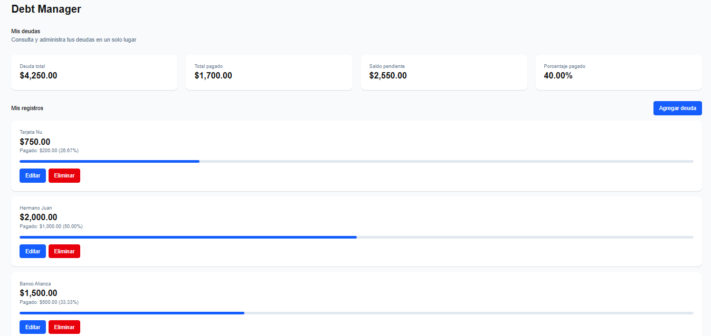
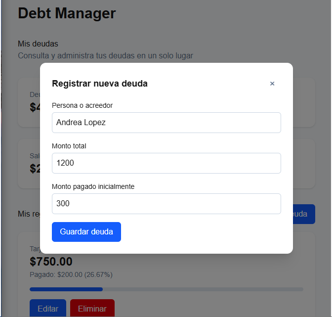
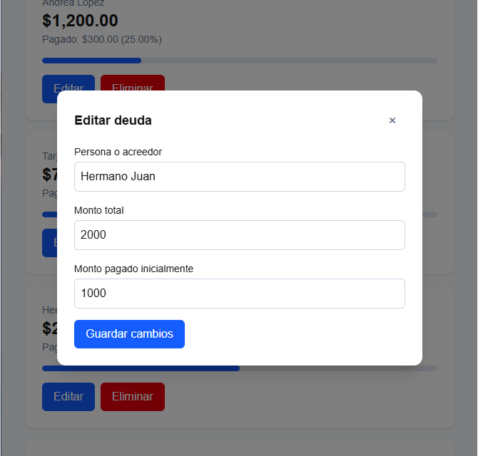

# Debt Manager

**Debt Manager** is a full-stack debt management application that allows users to register, track, update, and manage debts through a web interface.

The application includes an interactive dashboard to monitor total debt, payments, outstanding balances, and payment progress. It uses **FastAPI** for the REST API, **PostgreSQL** for persistent data storage, and **Next.js** for the frontend.

This project was developed as a learning-by-building initiative to strengthen practical software development skills, including backend and frontend development, database management, automated testing, containerization, and deployment.

## Live Demo

- **Application:** [Debt Manager](https://debt-manager-luis.vercel.app)
- **Backend API:** [API](https://debt-manager-a97o.onrender.com)
- **Interactive API documentation:** [Swagger UI](https://debt-manager-a97o.onrender.com/docs)

> **Note:** The free hosting services may temporarily sleep after periods of inactivity. The first request may take longer while the services start.

## Features

- Create, view, update, and delete debts.
- Track debt amounts and payments.
- Calculate outstanding balances automatically.
- Monitor total debt, total payments, and pending balances.
- Visualize payment progress through dashboard indicators.
- Validate user input and API requests.
- Persist records using PostgreSQL.
- Access debt management operations through a REST API.
- Use a command-line interface (CLI).
- Run automated backend tests with pytest.
- Run the application using Docker and Docker Compose.

## Tech Stack

### Backend Technologies

- **Python** — application logic.
- **FastAPI** — REST API development.
- **Pydantic** — data validation and serialization.
- **PostgreSQL** — relational database.
- **Psycopg** — PostgreSQL connectivity.
- **python-dotenv** — environment variable management.

### Frontend Technologies

- **Next.js** — React framework.
- **React** — user interface.
- **TypeScript** — static typing.
- **Tailwind CSS** — interface styling.

### Testing and Quality

- **pytest** — automated backend tests.
- **pytest-cov** — test coverage measurement.
- **ESLint** — frontend code analysis.
- **TypeScript** — frontend type checking.

### DevOps and Tools

- **Docker** — application containerization.
- **Docker Compose** — multi-container orchestration.
- **Git and GitHub** — version control.
- **Vercel** — frontend deployment.
- **Render** — backend deployment.
- **Neon** — managed PostgreSQL database.

## Architecture

Debt Manager follows a frontend-backend-database architecture:

1. The **Next.js frontend**, hosted on Vercel, provides the user interface.
2. The **FastAPI backend**, hosted on Render, exposes the REST API and handles application operations.
3. The **PostgreSQL database**, hosted on Neon, stores debt records persistently.

The frontend communicates with the backend through HTTP requests, while the backend handles database operations.

## Screenshots

### Dashboard



### Create a Debt



### Edit a Debt



## Project Structure

```text
debt-manager/
├── app/
│   ├── __init__.py
│   ├── api.py
│   ├── database.py
│   ├── debts.py
│   ├── inputs.py
│   └── main.py
│
├── tests/
│   ├── test_api.py
│   ├── test_database.py
│   ├── test_debts.py
│   └── test_main.py
│
├── frontend/
│   ├── public/
│   ├── src/
│   │   └── app/
│   ├── .env.example
│   ├── Dockerfile
│   └── package.json
│
├── .env.example
├── .gitignore
├── Dockerfile
├── docker-compose.yml
├── init.sql
├── pytest.ini
├── requirements.txt
├── requirements-dev.txt
└── README.md
```

- `app/` contains the Python backend, REST API, database operations, and debt management logic.
- `frontend/` contains the Next.js application and user interface.
- `tests/` contains the automated backend test suite.
- The root directory contains Docker configuration, database initialization, and Python dependencies.

## Requirements

For local development:

- Python 3.14+
- PostgreSQL
- Node.js and npm
- Git

For Docker:

- Docker Desktop or Docker Engine
- Docker Compose

## Installation

Clone the repository:

```bash
git clone https://github.com/luisglezgom15-collab/debt-manager.git
cd debt-manager
```

### Backend Setup

Create and activate a virtual environment:

```bash
python3 -m venv .venv
source .venv/bin/activate
```

Install dependencies:

```bash
pip install -r requirements-dev.txt
```

### Frontend Setup

```bash
cd frontend
npm ci
cd ..
```

## Environment Variables

### Backend Configuration

Create a `.env` file from the example:

```bash
cp .env.example .env
```

Configure the database connection:

```env
DB_HOST=127.0.0.1
DB_USER=debt_app
DB_PASSWORD=your_password
DB_NAME=debt_manager
FRONTEND_URL=http://localhost:3000
```

Make sure PostgreSQL is running and the configured database and user exist.

### Frontend Configuration

Create the local environment file:

```bash
cp frontend/.env.example frontend/.env.local
```

Configure the API URL:

```env
NEXT_PUBLIC_API_URL=http://127.0.0.1:8000
```

Never commit `.env` or `.env.local` files. Do not share database credentials or connection strings.

## Running the Application

### Start the Backend

From the project root:

```bash
source .venv/bin/activate
uvicorn app.api:app --reload
```

The API will be available at:

`http://127.0.0.1:8000`

Interactive API documentation:

`http://127.0.0.1:8000/docs`

### Start the Frontend

In a separate terminal:

```bash
cd frontend
npm run dev
```

The application will be available at:

`http://localhost:3000`

### Run the CLI

From the project root:

```bash
python -m app.main
```

The CLI provides options to:

1. View debts.
2. Add a debt.
3. Delete a debt.
4. Update a debt.
5. Exit.

## Running with Docker

Docker Compose starts three services:

- Frontend: Next.js.
- Backend: FastAPI.
- Database: PostgreSQL.

Make sure the root `.env` file exists and contains a non-empty `DB_PASSWORD`.

Build and start the containers:

```bash
docker compose up --build -d
```

Check their status:

```bash
docker compose ps
```

Access the services:

- Frontend: `http://localhost:3000`
- Backend: `http://localhost:8000`
- API documentation: `http://localhost:8000/docs`

View logs:

```bash
docker compose logs
```

Or display the latest 50 lines:

```bash
docker compose logs --tail=50
```

Stop the containers:

```bash
docker compose down
```

The PostgreSQL data volume is preserved when using this command.

To start the containers again without rebuilding:

```bash
docker compose up -d
```

### Database Persistence

Docker Compose uses a named volume called `postgres_data` to persist PostgreSQL data.

The database is initialized using `init.sql` when the PostgreSQL volume is created for the first time.

The Docker database is independent of any PostgreSQL database running directly on the host machine. Existing local database records are not automatically migrated into the Docker database.

**Warning:** Avoid using `docker compose down -v` unless you intentionally want to delete the PostgreSQL volume and its stored data.

## Running Tests

### Backend Tests

From the project root:

```bash
python -m pytest -v
```

To measure code coverage:

```bash
python -m pytest --cov=app --cov-report=term-missing
```

The backend test suite contains **69 automated tests**, all passing.

### Frontend Checks

From the frontend directory:

```bash
npm run lint
npx tsc --noEmit
npm run build
```

These commands check code quality, TypeScript types, and production build compatibility.

## Deployment

The production application uses the following services:

|Component|Platform|
|---|---|
|Frontend|Vercel|
|Backend|Render|
|Database|Neon PostgreSQL|

Environment variables are configured through each hosting provider rather than committed to the repository.

## Project Status

**Debt Manager 1.0 is deployed and functional.**

The current version includes:

- Full CRUD operations.
- Interactive web dashboard.
- Light and dark theme support.
- Custom confirmation dialogs for debt deletion.
- Debt settlement alerts and duplicate-name warnings.
- Debt and payment tracking.
- Backend and API validation.
- PostgreSQL integration and persistent storage.
- Command-line interface.
- 69 passing backend tests.
- Frontend linting, type checking, and production build validation.
- Dockerfiles and Docker Compose configuration.
- Cloud deployment with Vercel, Render, and Neon.

The application has been tested locally, with Docker, and in its deployed environment, including database connectivity and debt creation, editing, and deletion.

## Current Limitations

- Version 1.0 does not include user registration or authentication.
- Debt records are not separated by user.
- The API currently allows public CRUD access.

**Important:** Do not use real personal or financial information. This version is intended as a portfolio and learning project. CORS configuration does not provide authentication or access control.

## Future Improvements

Planned improvements for future versions:

- User registration and authentication.
- Secure user-specific debt management.
- Detailed debt payment history.
- Individual payment tracking.
- More advanced dashboard analytics and financial insights.
- Further user interface and user experience improvements.

---

Developed by **Luis Gonzalez**.

GitHub: [luisglezgom15-collab](https://github.com/luisglezgom15-collab)